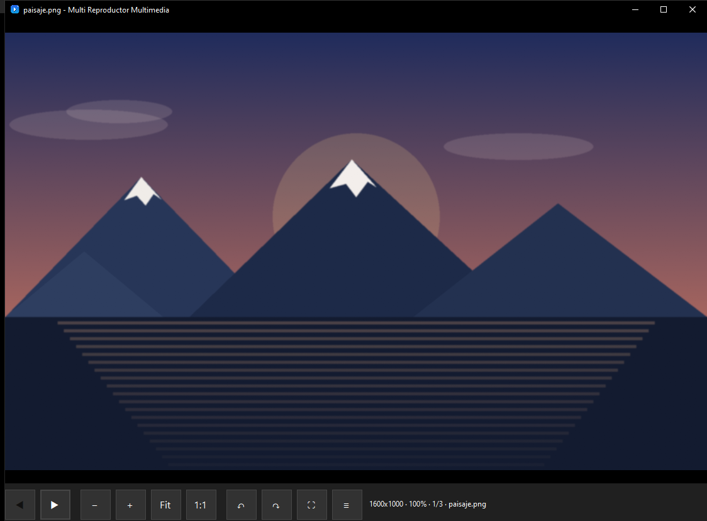
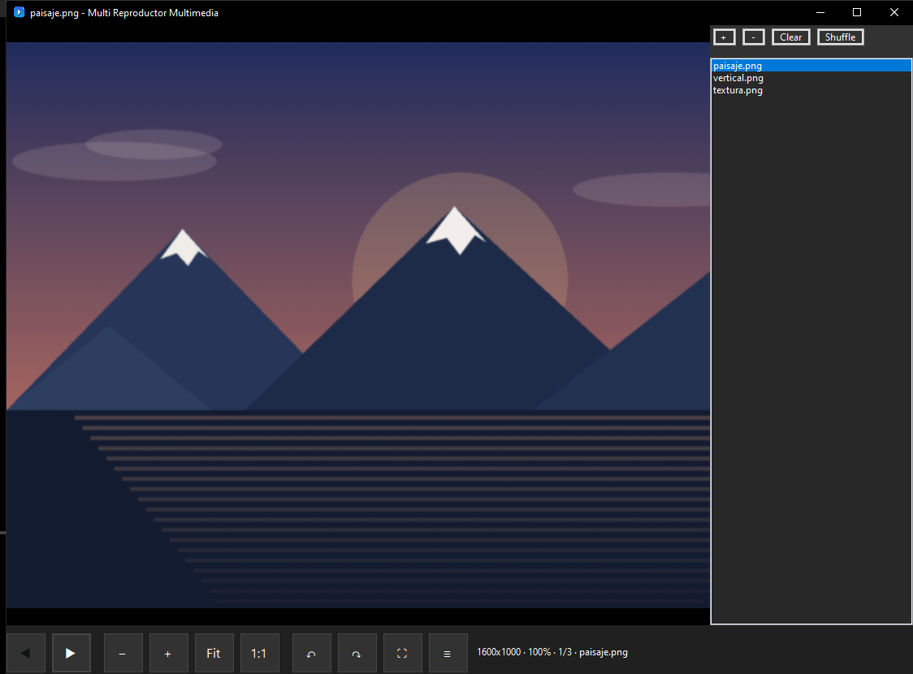
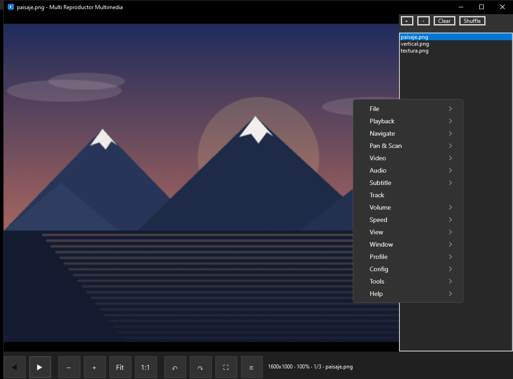

# Multi Reproductor Multimedia

<p align="center"></p>

Reproductor de vídeo, audio e imágenes para Windows, basado en **mpv.net** y **libmpv**. Mantiene la potencia y la configuración de mpv, con una interfaz sencilla y un visor de imágenes cómodo. No requiere instalación: descomprime la carpeta y ejecuta el `.exe`.



## Qué hace

- Reproduce los formatos habituales de vídeo y audio (MKV, MP4, AVI, WebM, MP3, FLAC, etc.) y las imágenes más comunes (JPG, PNG, GIF, WebP, BMP).
- Controles de reproducción con progreso, volumen, velocidad y pantalla completa; pistas y subtítulos desde el menú.
- Visor de imágenes con zoom, arrastre, ajuste, tamaño real y rotación.
- Centra cada imagen en el monitor actual al abrirla.
- Lista de reproducción con añadir, quitar, vaciar y mezclar.
- Menú contextual con las opciones habituales de mpv.net.
- Compatible con la configuración, los atajos, los comandos y los scripts de mpv.
- Asociación de archivos opcional desde `Config > Setup`.

## Capturas

| Lista de reproducción | Menú contextual |
| --- | --- |
|  |  |

## Requisitos

- Windows 10 u 11 de 64 bits.
- [.NET 10 Desktop Runtime](https://dotnet.microsoft.com/en-us/download/dotnet/10.0).
- Los binarios nativos `libmpv-2.dll`, `MediaInfo.dll` y `D3DCompiler_47_cor3.dll` junto al ejecutable.

La carpeta `reproductor-multimedia`, una vez copiados los binarios nativos, ya incluye todo lo necesario salvo el runtime de .NET.

## Uso rápido

1. Ejecuta `MultiReproductorMultimedia.exe`.
2. Abre un archivo arrastrándolo a la ventana, desde el menú contextual (`File > Open Files...`) o pasando la ruta por línea de comandos.
3. Para varios archivos, puedes abrirlos todos a la vez o añadirlos después desde el panel de lista de reproducción.
4. El botón `≡` de la barra inferior muestra u oculta la lista de reproducción.

## Manual rápido

### Imágenes

- Rueda del ratón: zoom anclado al cursor.
- Arrastrar con el botón izquierdo: mover la imagen ampliada.
- `Fit`: ajustar a la ventana.
- `1:1`: tamaño real.
- `↶` / `↷`: girar 90 grados.
- `⛶`: pantalla completa.
- `≡`: lista de reproducción.
- Al abrir una imagen, la ventana se centra en el monitor actual y la imagen empieza ajustada y centrada.

### Vídeo

- Barra inferior: anterior, reproducir/pausar, detener, siguiente, progreso, volumen, silencio, velocidad, pantalla completa y lista.
- Rueda del ratón: zoom.
- Arrastrar: mover la imagen cuando está ampliada.
- Los atajos y comandos de mpv siguen funcionando.

### Audio

- Barra inferior con reproducción, progreso, volumen, silencio, velocidad, mezcla, repetición y lista.
- Si el archivo trae carátula, se muestra como imagen y se puede hacer zoom y arrastrar.

### Lista de reproducción

- `+` añade archivos.
- `-` quita el seleccionado.
- `Clear` vacía la lista.
- `Shuffle` mezcla la lista.
- Doble clic en una entrada para reproducirla.
- `F8` muestra u oculta el panel.

### Atajos propios del visor

| Acción | Atajo |
| --- | --- |
| Zoom con la rueda | Rueda del ratón |
| Mover imagen | Arrastrar con el botón izquierdo |
| Imagen anterior / siguiente | `←` / `→` |
| Acercar / alejar | `+` / `-` |
| Ajustar y centrar | `0` |
| Girar 90 grados | `R` |

## Configuración

La configuración se busca en este orden:

1. Carpeta indicada por la variable `MPVNET_HOME`.
2. `portable_config` junto al ejecutable.
3. `%APPDATA%\mpv.net`.

Dentro se usan los mismos archivos que en mpv.net: `mpv.conf`, `mpvnet.conf`, `input.conf` y la carpeta de scripts.

## Compilar

Necesitas el [.NET 10 SDK](https://dotnet.microsoft.com/en-us/download/dotnet/10.0) y Windows.

```powershell
dotnet build src\MpvNet.sln -c Release

dotnet publish src\MpvNet.Windows\MpvNet.Windows.csproj `
  -c Release -r win-x64 --self-contained false `
  -o reproductor-multimedia
```

Después copia los binarios nativos a la carpeta generada:

```powershell
Copy-Item libmpv-2.dll reproductor-multimedia\
Copy-Item MediaInfo.dll reproductor-multimedia\
Copy-Item D3DCompiler_47_cor3.dll reproductor-multimedia\
```

Esos archivos no se compilan desde este repositorio. Puedes obtenerlos de una instalación o release de [mpv.net](https://github.com/mpvnet-player/mpv.net/releases).

Para probar la compilación:

```powershell
.\reproductor-multimedia\MultiReproductorMultimedia.exe
```

## Estructura

- `src/MpvNet`: núcleo, reproductor, configuración y utilidades.
- `src/MpvNet.Windows`: interfaz WinForms/WPF y punto de entrada.
- `src/MpvNet.Extension`: extensiones compartidas.
- `src/NGettext.Wpf`: traducciones.
- `src/Setup`: instalador de Inno Setup.
- `src/Tools`: scripts de publicación.
- `docs/img`: capturas usadas en este README.

## Créditos

Proyecto derivado de [mpv.net](https://github.com/mpvnet-player/mpv.net), de [mpv](https://mpv.io) y de libmpv. Las licencias y condiciones de esos proyectos siguen aplicando.
